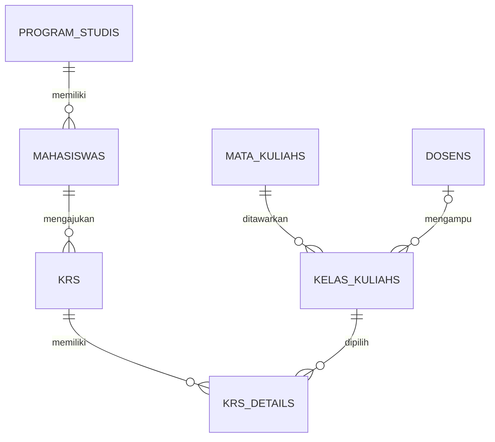

# Dokumentasi desain database

## ERD ringkas

## Index yang direncanakan
- `mahasiswas(program_studi_id, angkatan)` untuk filter mahasiswa per prodi dan angkatan.
- `kelas_kuliahs(tahun_akademik, semester)` untuk daftar kelas per periode.
- Unique NIM, email, NIDN, kode mata kuliah, dan kode prodi untuk pencarian identitas unik.

Index bukan ditambahkan ke semua kolom. Evaluasi kembali dengan `EXPLAIN` ketika pola query dan volume data sudah representatif.
